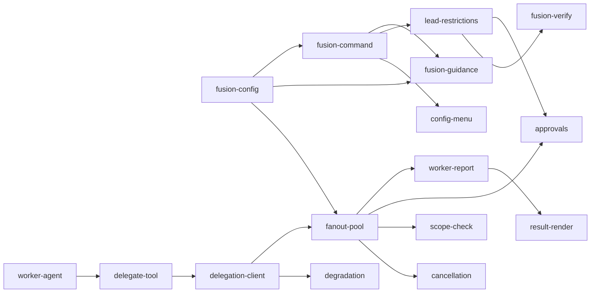

# Product Plan: pi-fusion — Fusion-режим для pi coding agent

> Status: Approved (2026-10-31)
> Source: сессия анализа atomic-agent Fusion + ресёрч pi-экосистемы; @[.ai/sdd/ideas/001-fusion-mode-for-pi.md]
> Last Updated: 2026-10-31

## Vision

**pi-fusion** — расширение для pi coding agent, воспроизводящее Fusion-режим atomic-agent
(архитектура Cognition «lead + cheap workers»): главная сессия (фронтир-модель = лид)
получает один тул `fusion_delegate` и гайданс `### fusion`; независимые части работы
(широкие чтения, черновики, шаблонный код, тесты, поиски) веером исполняют эфемерные
дешёвые воркеры — fresh-context субагенты через delegation-шов pi-subagents. Лид
проверяет отчёты против брифов и повторным вызовом тула отправляет переделки. Экономика:
дорогая модель думает и ревьюит, дешёвые (или локальные llama-server) пашут.

## Steering Context

- Product: N/A (новый репозиторий)
- Tech Stack: N/A
- Conventions: N/A
- Principles: N/A
- Domain: @.ai/sdd/ideas/001-fusion-mode-for-pi.md (исследовательский контекст)

## Personas

| Persona | Needs | Pains | Goals |
|---------|-------|-------|-------|
| Оператор (владелец, разработчик) | Экономия токенов фронтира; контроль скоупа записи; понятный статус fan-out | Рутина исполняется дорогой моделью; нет мультиагентного fan-out «из коробки» | Давать лиду задачи и получать результат дешевле без потери качества плана/ревью |
| Лид-модель (фронтир в главной сессии) | Один понятный тул; честные факты о ширине/слотах; статусы по каждой задаче | Без гайданса не делегирует (прочтёт всё сам) | Планировать, раздавать, проверять — не делать рутину самому |
| Воркер-модель (дешёвая нога) | Самодостаточный бриф; жёсткая политика; ограниченные тулы | Не видит переписку лида; ограниченный контекст | Выполнить одну задачу и вернуть структурный отчёт |

## MVP Boundary

### Must Have

- Тул `fusion_delegate` с контрактом atomic-agent (tasks/files/maxWorkers/contract) и
  структурным отчётом воркера; клампы ширины; пул с per-model cap ≤ 2; ротация моделей.
- Delegation-шов клиент (порт `council-delegation.ts`): request/response по requestId,
  таймаут+15s grace, usage только из терминальных ответов (`:update` — лишь
  диагностика и turnsObserved; уточнено при ревью спеки 001), dispose.
- Агент `fusion-worker.md` (allowlist тулов, политика, fresh) + установка в
  `~/.pi/agent/agents/`.
- Гайданс `### fusion` через `before_agent_start` (append, идемпотентно).
- Конфиг `~/.pi/agent/fusion.json` + команда `/fusion` с автодополнением подкоманд
  (on/off/status/workers/model/timeout/help).
- Деградация: шов недоступен → «делай работу сам».
- Ограничение лида (F19): при fusion лиду механически заблокированы `write`, `edit` и `bash` — код пишут и проверки гоняют воркеры; отказ зависит от фазы turn'а, barren-счётчик (2 пустых fan-out'а) прерывает петлю при мёртвой ноге.
- Базовый approval: один `ctx.ui.confirm` на fan-out (задачи + скоуп записи).

### Should Have

- Полная семантика approval: standing-yes на ход, declinedInScope повторный вопрос,
  сброс на `turn_end`, поведение в headless.
- Скоуп-чек: `filesChanged` ⊆ `files`, иначе `needs_orchestrator` + именованный путь;
  отчёт о заменённых файлах.
- Отмена (`ctx.signal` → `:cancel`) и частичные результаты.
- TUI-рендер тула (`renderCall`/`renderResult`, таблица статусов).
- Интерактивное меню `/fusion config` в стиле pi-autoresearch + установка агента из меню.

### Could Have

- Живые строки воркеров в ленте (через `:update`).
- Маршрутизация `contract.provides[].shape` в брифы зависимых задач.
- Пер-проектный override конфига (`.pi/fusion.json`).
- Пресет/доки локальной ноги llama-server через models.json.

### Won't Have Yet

- Workflow-движок и lead-ребёнок (лид — только главная сессия).
- In-process воркер-тёрны (в pi воркеры — субагенты через шов).
- Рекурсивное делегирование воркерами (запрещено конструктивно).
- Принудительное enforcement каталогов записи (только пост-чек и approval).
- Авто-merge веток/кампании (это зона pi-agile, не fusion).

## Feature Map

### Phase 1 — MVP (Must Have)

| ID | Feature | Module | Description | Success Criteria |
|----|---------|--------|-------------|------------------|
| F01 | fusion-config | `config.ts` | `fusion.json`: load/persist, дефолты, валидация (enabled, workerModels[], workers, maxParallel, taskTimeoutMs, requireApproval, blockedTools — воркерам, leadBlockedTools — лиду, дефолт `["write","edit","bash"]`) | Читается/пишется атомарно; битый JSON → дефолты + warn |
| F02 | fusion-command | `index.ts` | `/fusion` + `getArgumentCompletions` (on/off/status/workers/model/timeout/help); on/off дёргает active tools + секцию промпта | Подкоманды работают, autocomplete в TUI, состояние переживает рестарт |
| F03 | fusion-worker-agent | `agents/fusion-worker.md` | Отдельный агент: allowlist `read, grep, find, ls, bash, edit, write`, политика воркера (в т.ч. запустить проверки и приложить вывод в `evidence`), `defaultContext: fresh`, `inheritSkills: false`; установщик файла в `~/.pi/agent/agents/` | Агент резолвится pi-subagents; в allowlist нет fusion/subagent/codemode |
| F04 | delegate-tool | `tool.ts` | Тул `fusion_delegate`: контракт atomic-agent (tasks/id/instructions/title/deliverable/files/maxSteps/timeoutMs, maxWorkers, contract), parse/validate, `isError`-семантика для кривого контракта | Контракт принимается/отклоняется как в atomic-agent; тесты на схему |
| F05 | delegation-client | `delegation.ts` | Порт шва из pi-autoresearch: события request/response, маршрутизация requestId, ownerRunId `fusion-<seq>-<ts>`, timeout+15s, dispose, usage — только терминальные ответы (Σ по попыткам; `:update`-снимки НЕ суммируются — лишь диагностика и счётчик `turns` на ребёнка: честный сигнал «воркер исполнил хоть что-то» — вход barren-детекции F19) | Смоук на fake-pi: ответ маршрутизируется; usage и turns попадают в result |
| F06 | fanout-pool | `pool.ts` | Пул ширины: `maxWorkers` (кламп ≤ tasks, ≤ maxParallel, per-model ≤ 2), FIFO-очередь, ротация `workerModels`, результат в порядке индексов задач, флаги клампа в result; **окно rate-limit (FR-011) — часть пула**: 5 подряд window-429 → модель исключается, её дети отменяются, ТЕ ЖЕ задачи перезапускаются на новой модели с continuation-брифом (≤2 спасений); timeout/перегрузка — терминальный отказ задачи; пустая ротация → все failed(no-available-model) | Тесты: порядок, клампы, cap на модель, окно 429×5 (duplicate_node-защита попытко-специфичным nodeId — для спасений и schema-ретрая), пустая ротация без зависания |
| F07 | worker-report | `report.ts` | Структурная схема отчёта (status/summary/filesChanged/evidence/residualRisks/replacedExistingFiles/question), валидация, 1 ретрай при schema-missing | Кривой отчёт → 1 ретрай → failed с пометкой |
| F08 | fusion-guidance | `guidance.ts` | Секция `### fusion` (порт FUSION_GUIDANCE + machine facts) через `before_agent_start`: append в `systemPromptOptions`, идемпотентно, снимается при off; НИКОГДА `forceSystemPrompt`. Стратегия верификации лида: evidence из отчётов воркеров и/или делегирование проверок свежему воркеру (своего bash у лида нет) | Секция появляется/исчезает с режимом; нет дублей |
| F09 | degradation | `delegation.ts` | `delegationAvailable(pi) === false` или `unavailable_context` → сообщение «fusion недоступен — делай работу сам» | Тест деградации; лид получает действенную ошибку |
| F19 | lead-restrictions | `restrictions.ts` | При включённом fusion хендлер `tool_call` в главной сессии блокирует мутирующие тула лида: `write`, `edit` и `bash` **целиком** (через bash мутируют python/sed/redirect — классификация команд ненадёжна, поэтому полный блок); список — `leadBlockedTools` в конфиге; при off — пропуск. Тексты отказа зависят от состояния (порт atomic-agent `fusion-orchestrator-mode`): до первого fan-out — «планируй и делегируй», после — «отправь переделку; `needs_orchestrator` = новый fan-out с путями в `files`, не захватывай работу сам»; мутации не разблокируются никогда в рамках turn'а. **Barren-счётчик**: 2 подряд fan-out'а, где воркеры исполнили 0 шагов (`turns` из F05) → текст отказа меняется на «воркер-нога не работает — скажи оператору» вместо «делегируй ещё» | Тесты: блок в режиме, пропуск при off, оба текста отказа, переключение barren после 2 пустых fan-out'ов |

### Phase 2 — Essentials (Should Have)

| ID | Feature | Module | Description | Success Criteria |
|----|---------|--------|-------------|------------------|
| F10 | approvals | `approvals.ts` | Один `ctx.ui.confirm` на fan-out (задачи + каталоги записи); standing-yes на ход в рамках одобренных каталогов; declinedInScope → повторный вопрос; сброс на `turn_end`; headless-поведение по конфигу | Тесты standing-yes/decline/turn_end |
| F11 | scope-check | `scope.ts` | `filesChanged` ⊆ `files` (prefix-match), иначе `needs_orchestrator` + именованные пути; отчёт `replacedExistingFiles` в таблице | Тесты скоупа; вне скоупа возвращает путь, не фейлит вызов |
| F12 | cancellation | `tool.ts` | `ctx.signal` → `:cancel` по pending; частичный результат: завершившиеся — своими статусами, прерванные — `cancelled` | Esc не теряет завершившихся задач |
| F13 | result-render | `render.ts` | `renderCall` (список задач + ширина) / `renderResult` (таблица статусов, цвета) | Рендер в TUI и HTML export не падает |
| F14 | config-menu | `menu.ts` | `/fusion config` — цикл меню как в pi-autoresearch (`ctx.ui.select/input/confirm/notify`, RU/EN-словарь `L.*`): ротация моделей, ширина, maxParallel, таймаут, approval-тумблер, blockedTools, «установить/обновить агента» | Цикл меню с валидацией; сохранение; установка агента с уведомлением |
| F20 | fusion-verify | `verify.ts` | Аналог atomic-agent `verify.run` для лида: расширение само (child_process из Node, не bash лида) запускает команду в одноразовой копии рабочего каталога (git-снапшот/worktree; переиспользование node_modules — по конфигу) — ничего не пишет в workspace; декларативные `checks` («exit 0», «stdout contains …», «status 200»); в реестре read-only-класс — F19 его не блокирует (как `verify.syntax` у atomic-agent, decision D1) | Тесты: изоляция копии (мутации не доходят до workspace), checks, F19 пропускает |

### Phase 3 — Nice to Have (Could Have)

| ID | Feature | Module | Description | Success Criteria |
|----|---------|--------|-------------|------------------|
| F15 | live-worker-lines | `render.ts` | Строки «worker started/finished» в ленте через `:update` (если найдём точку рендера исполняющегося тула) | Строки появляются в реальном времени |
| F16 | contract-routing | `tool.ts` | `contract.provides[].shape` вклеивается в брифы зависимых задач (порт семантики atomic-agent) | Зависимая задача получает shape-строки провайдеров |
| F17 | project-override | `config.ts` | Пер-проектный `.pi/fusion.json` поверх глобального | Override читается, приоритет документирован |
| F18 | local-leg-preset | `menu.ts`, docs | Пресет/доки локальной ноги llama-server через models.json (+ пункт меню) | Подключение локальной ноги без изменений кода |

## Dependencies

Примечание: один спек может покрывать связку F04–F07+F09 («движок fan-out») — они
разделяют схему отчёта и клиент шва.

## Rollout Plan

| Phase | Goal | Included Features | Exit Criteria |
|-------|------|-------------------|---------------|
| MVP | End-to-end fan-out на машине владельца | F01–F09, F19 | Живой прогон: лид с fusion on делит задачу на ≥ 2 части, воркеры параллельно завершаются, отчёты возвращаются, лид отвечает; лид не пишет код (write/edit/bash заблокированы); смоук-тесты на fake-pi зелёные; деградация честная |
| Essentials | Паритет с atomic-agent по безопасности и UX | F10–F14 | Standing-yes, скоуп-чек, отмена, рендер, меню — тесты зелёные |
| Polish | События и маршрутизация | F15–F18 | Живые строки и/или contract-routing; локальная нога подключается без кода |

## Risks and Mitigations

| Risk | Impact | Mitigation |
|------|--------|------------|
| Version skew delegation-шова pi-subagents (эволюция API событий) | High | Пин версии в README; smoke-проверка шва при старте; честная деградация F09 |
| Квоты/429 дешёвых моделей под параллельной нагрузкой | Medium | Per-model cap ≤ 2, ротация workerModels, статусы failed per-task, лид перепланирует |
| Воркеры пишут вне объявленного скоупа в MVP | Medium | Базовый approval в MVP; F11 (пост-чек → needs_orchestrator) ранним Should; политика в агенте |
| Кривые структурные отчёты дешёвых моделей | Medium | Schema-валидация + 1 ретрай отчёта (F07); финально failed с пометкой |
| Инвалидация кэш-префикса при переключении active tools / секции | Low | Задокументировано; переключение — операторское действие (как `/runmode` в atomic-agent) |
| Лид без bash не может сам гнать проверки (тесты/линт) | Medium | Политика воркера F03: проверки запускаются воркером, вывод — в `evidence` отчёта; независимая верификация = делегирование свежему воркеру; F20 вернёт лиду самопроверку в копии; оператор всегда может проверить сам |
| Воркер-нога недоступна (дети не стартуют/0 шагов) → лид петлёй переделок | Medium | Barren-счётчик F19: 2 подряд fan-out'а с нулём шагов → отказ говорит «скажи оператору», а не «делегируй ещё» (порт atomic-agent BARREN_DELEGATION_LIMIT) |
| Маленький контекст дешёвых моделей на широких брифах | Medium | Самодостаточные, но короткие брифы; гайданс «keep briefs short» (порт); клампы ширины |
| Расширение конфликтует с другими, мутирующими `systemPromptOptions` | Low | Идемпотентная секция с фиксированным заголовком; in-place мутация без forceSystemPrompt |

## Open Decisions

- Блокирующих нет: решения A–G согласованы с владельцем (см. idea-файл).
- Отложено сознательно: пер-проектный конфиг (F17), live-строки (F15) — Could Have.

## Next Step

После аппрува плана — создать `requirements.md` первого спека
`specs/001-fanout-engine/` (покрывает F04–F07, F09: тул + шов + пул + схема отчёта +
деградация), затем `requirements.md` для F01–F03 (конфиг/команда/агент).
