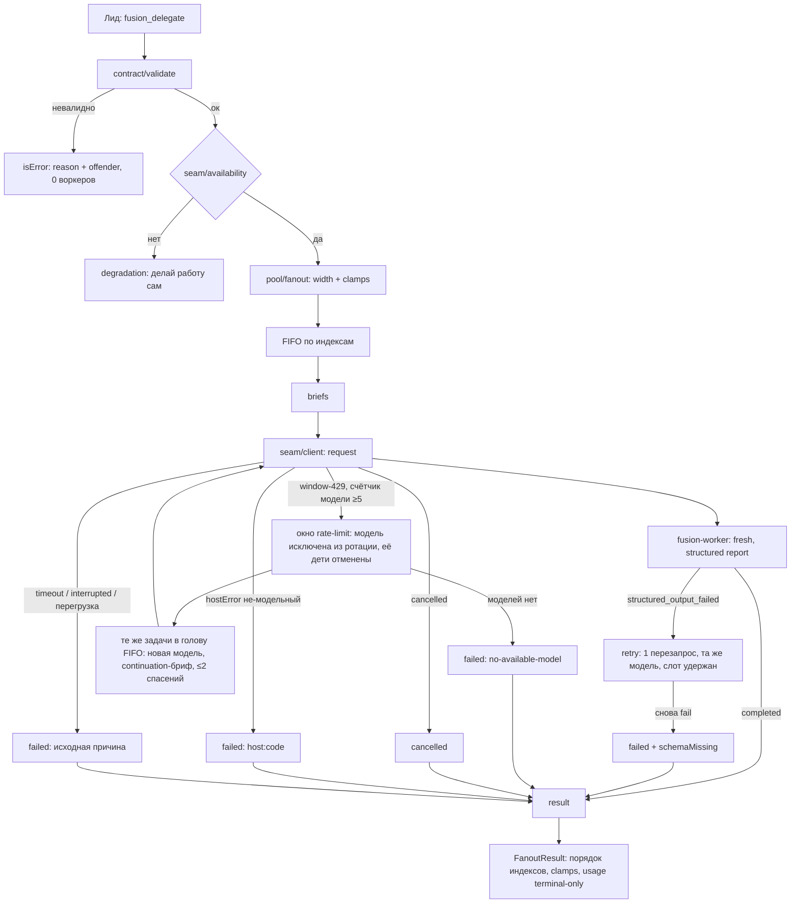

# Design: fanout-engine (F04–F07, F09 + FR-011 model-window)

> Requirements: @[requirements.md](requirements.md)
> Status: Draft (rev.5.0 — решение владельца 2026-10-31: FR-011 переписан — окно rate-limit 429×5 → исключение модели + отмена её детей + перезапуск тех же задач с continuation-брифом; timeout/перегрузка — не вина модели; предшествующие — R1-R7 + финальное ревью пакета)
> Last Updated: 2026-10-31

## 1. Executive Summary

Fan-out исполняется внутри процесса расширения pi-fusion как один вызов тула
`fusion_delegate`: валидация контракта → проверка доступности delegation-шва
pi-subagents → пул ширины, который через шов спавнит ephemeral fresh-воркеров
(агент `fusion-worker`, модель из ротации), собирает их структурные отчёты и
возвращает агрегированный результат. Ключевые решения rev.2: полный маппинг всех
статусов шва (`structured_output_failed` запускает ретрай отчёта FR-007; окно
rate-limit 429×5 — исключение модели FR-011), `toolBudget.hard` обязателен
(= `maxSteps`), usage — только из терминальных ответов (authoritative; `:update` —
снимки, не дельты), отказ последней доступной модели осушает очередь немедленным
failed (без дедлока), окно rate-limit = исключение модели + отмена её детей +
перезапуск тех же задач с continuation-брифом (непрерывность — состояние на диске;
живая смена модели у работающего ребёнка швом недоступна — future work, TD-006),
dispose резолвит висящие промисы. Trade-off: ход лида блокируется
на весь fan-out (сознательно — паритет с atomic-agent); TUI живёт (Node event loop).

## 2. Requirements Mapping

| Requirement | Design Coverage | Notes |
|---|---|---|
| FR-001 контракт | §4 types.ts, §4 briefs | cap 1..16 (D-005) |
| FR-002 валидация | §4 contract/validate.ts, §8 | отказ до запуска; `contract` — объект |
| FR-003 ширина/клампы | §4 pool: цепочка клампов | формула + ClampRow-условия |
| FR-004 per-model cap | §4 pool: ротация + счётчики | ≤ 2 на модель; capacity-фактор |
| FR-005 порядок/полнота | §4 result.ts | сортировка по индексам; приоритет статусов |
| FR-006 отчёт по схеме | §4 report/schema.ts | TypeBox; question обязателен при needs_orchestrator |
| FR-007 ретрай отчёта | §4 report/retry.ts | триггер `structured_output_failed`; слот удерживается |
| FR-008 таймауты/бюджет/изоляция | §4 seam/client.ts, §5 | hard=maxSteps; 4× потолок; `:cancel` на grace |
| FR-009 деградация | §4 availability, degradation | pre-flight весь вызов; mid-run — по-задачно |
| FR-010 usage | §4 result.ts (Usage) | терминальные ответы; absent = unknown |
| FR-011 model-window | §4 pool: Окно rate-limit | 429×5 подряд → исключение модели + отмена детей + перезапуск задач (≤2 спасения); timeout/перегрузка — не вина модели |
| NFR-001 usability | §7 | таблица + клампы |
| NFR-002 performance | §7 | время ≈ Σ(длительности задач)/W |
| NFR-004 security | §6 | block-list + hard |
| NFR-005 reliability | §8, §11 | отказ per-task; dispose; частичные результаты |

## 3. System Architecture

### Component Overview

| Component | Responsibility | Boundaries | Notes |
|---|---|---|---|
| `contract/schema.ts` | TypeBox-схема аргументов тула | форма без логики | 1..16 задач; `contract` — объект |
| `contract/validate.ts` | семантическая валидация (dup id, contract не объект и т.п.) | reason + offender | до шва |
| `seam/availability.ts` | проверка шины событий | boolean | ограничение — §15 R3 |
| `seam/client.ts` | подписки, run(), cancel(), dispose() | 1 клиент на fan-out; dispose резолвит pending | статусы → SeamOutcome |
| `pool/fanout.ts` | ширина, клампы, FIFO, ротация, per-model cap, окно rate-limit | не знает формат брифа | дренаж при «нет моделей» |
| `briefs.ts` | бриф задачи + continuation-бриф спасения | чистые функции | контракт — JSON-блок |
| `report/{schema,validate,retry}.ts` | отчёт, violatedFields, 1 ретрай | | ретрай на той же модели |
| `result.ts` | FanoutResult: строки, клампы, usage | чистая функция | structured + text + details |
| `degradation.ts` | отказы «делай сам» | pre-flight текст; mid-run — per-task | |
| `config-bridge.ts` | workers, maxParallel, taskTimeoutMs, workerModels, maxSteps | read-only кэш | полный F01 в 002 |
| `test/fake-pi.ts` | фейковая шина + response-гейты + fake timers | тест-инфраструктура | детерминизм расписания |

### Data / Control Flow



## 4. Implementation Design

### Module Structure

```text
extensions/pi-fusion/
  index.ts            # registerTool("fusion_delegate", { exposure: "direct" }) + немедленная дизактивация setActiveTools (§13); команды — 002/004
  contract/{schema.ts, validate.ts}
  seam/{availability.ts, client.ts}
  pool/fanout.ts
  briefs.ts
  report/{schema.ts, validate.ts, retry.ts}
  result.ts
  degradation.ts
  config-bridge.ts
  types.ts
test/
  fake-pi.ts
  contract.test.ts  pool.test.ts  window.test.ts  report.test.ts
  seam-client.test.ts  fanout-e2e.test.ts  degradation.test.ts
```

### Core Interfaces

```ts
// types.ts — формы; контракт дословно atomic-agent с задокументированными отклонениями (§14 TD-007)
interface FusionTask {
  id: string; instructions: string; title?: string; deliverable?: string;
  files?: string[]; maxSteps?: number; timeoutMs?: number; etaSeconds?: number; // etaSeconds — принимаем, не используем в 001
}
// Валидация ПОРТИРУЕТСЯ из atomic-agent (delegate-args.ts:306-520, contract.ts,
// contract-inputs.ts) — TD-007. Правила порта дословно:
// object; inputs ≤ 32 (string[], trim+дедуп); owners?: Record<path, taskId> — ссылки
// ТОЛЬКО на известные задачи, пустые пути отклоняются; provides?: {task, kind, name,
// in?, shape?}[] — ≤ MAX_CONTRACT_PROVIDES(64), kind ∈ 7 значений атомика
// (symbol|file|id|endpoint|env|flag|other), shape ≤ 200 и ОБРЕЗАЕТСЯ (не отказ);
// requires?: {task: известная задача, name: непустая строка} (contract.ts:89-97,
// delegate-args.ts:430-454); checks?: ({task?} & Record)[] ≤ MAX_CONTRACT_CHECKS(16),
// пустой spec отклоняется; рендер блока контракта > MAX_CONTRACT_RENDERED_CHARS
// (8000) = ОТКАЗ вызова, не clamp (delegate-args.ts:497-503). Философия атомика:
// «смысл контракта не отказывается» — несбываемое уходит в warnings (contractWarnings
// ВЫЧИСЛЯЕТ парсер, на вход не принимается — M4-R3).
interface DelegateContract {
  inputs?: string[];
  owners?: Record<string, string>;
  provides?: Array<{ task: string; kind: string; name: string; in?: string; shape?: string }>;
  requires?: Array<{ task: string; name: string }>;
  checks?: Array<{ task?: string } & Record<string, unknown>>;
}
interface FusionContract { tasks: FusionTask[]; maxWorkers?: number; contract?: DelegateContract }

// Самодекларация воркера — 4 статуса; no_changes — паритет атомика (там он выводится
// из фактов записи declared-files.ts; у нас — самодекларация fresh-воркера, отклонение задокументировано TD-007)
interface WorkerReport {
  status: "done" | "no_changes" | "failed" | "needs_orchestrator";
  summary: string; filesChanged: string[]; evidence: string[]; residualRisks: string[];
  replacedExistingFiles?: string[]; question?: string; // обязателен при needs_orchestrator
}

// Взгляд рантайма: расширяет отчёт состояниями шва (B7)
interface TaskResult {
  id: string;
  status: "done" | "no_changes" | "failed" | "needs_orchestrator" | "cancelled";
  summary: string; filesChanged: string[]; evidence: string[]; residualRisks: string[];
  question?: string;
  error?: string;        // machine-code: timeout | max_steps | schema-missing | acceptance-failed |
                         // seam-unavailable | no-available-model | window-rescue-exhausted | host:<code>
  schemaMissing?: boolean;
  attempts: number;      // запусков воркера по задаче (0..3: старт + ≤2 спасения окна
                         // FR-011; 0 = не запущена — пустая ротация/дренаж; schema-ретрай
                         // FR-007 не считается)
  turns?: number;        // Σ терминальных usage.turns ПО ВСЕМ попыткам; отсутствие = unknown (не 0!)
  turnsObserved?: number; // последний :update-снимок ПОСЛЕДНЕЙ попытки (снимки per-attempt,
                          // delegation.d.ts:44-47); fallback для barren-детектора F19
}

// Поля = SubagentDelegationUsage шва (delegation.d.ts:99-108), включая durationMs
// (M7-R3); необязательные, потому что шов может не прислать usage; сумма только
// присутствующих по всем попыткам; «нет данных» ≠ 0 (B4-R1)
interface UsageTotals { input?: number; output?: number; cacheRead?: number;
                        cacheWrite?: number; cost?: number; turns?: number; toolCalls?: number;
                        durationMs?: number }
// Снимок :update (SubagentDelegationUpdateUsage, delegation.d.ts:49-55) — БЕЗ cost и
// toolCalls, кумулятивный в рамках ОДНОЙ попытки; отдельный тип (M7-R3)
interface ProgressSnapshot { input: number; output: number; cacheRead: number;
                             cacheWrite: number; turns: number }

interface ClampRow { field: "maxParallel" | "tasks" | "perModel" | "noModels";
                     requested: number; applied: number; reason: string } // noModels — пустая ротация (B-FINAL); «maxWorkers» удалён (MINOR-2-R8: ни один фактор его не производит)
interface FanoutResult { results: TaskResult[]; clamps: ClampRow[]; usage: UsageTotals;
                         usagePartial: boolean } // usagePartial: хоть одна задача без терминального usage
```

```ts
// seam/client.ts — один клиент на fan-out; dispose резолвит pending (B9)
interface FanoutSeamClient {
  run(req: { nodeId: string; task: string; model: string; timeoutMs: number;
             hardToolBudget: number;
             onProgress?: (snapshot: ProgressSnapshot) => void }): // кумулятивный снимок одной попытки
    Promise<SeamOutcome>;
  cancel(requestId: string): void;   // :cancel {requestId, ownerRunId, nodeId} — строго эти поля
  dispose(): void;                   // отписки + resolve всех pending run() как {kind:"cancelled"}
}
type SeamOutcome =
  | { kind: "report"; report: WorkerReport; usage?: UsageTotals }  // completed
  | { kind: "schemaFailed"; usage?: UsageTotals }                  // structured_output_failed → FR-007
  | { kind: "timeout"; usage?: UsageTotals }                       // timed_out (хост, usage может быть);
                                                                   // локальный grace — usage НЕТ (= unknown)
  | { kind: "interrupted"; usage?: UsageTotals }                   // interrupted
  | { kind: "cancelled"; usage?: UsageTotals }                       // терминал aborted (адаптер прикладывает
                                                                   // usage без гейта по статусу — B-2-R5);
                                                                   // локальный dispose-resolve — usage НЕТ (= unknown)
  | { kind: "unavailableContext" }                                 // unavailable_context
  | { kind: "hostError"; code: string; message: string;
      modelAttributable: boolean; usage?: UsageTotals };  // остальное: invalid_request,
                                  // duplicate_node, tool_budget_exhausted, no-structured-output,
                                  // 429/overload/…; modelAttributable = true по классификации ниже:
                                  // структурный rate_limited ИЛИ case-insensitive substring
                                  // 429/overload/rate-limit/quota (единый список Q-002).
                                  // B-2-R5: адаптер прикладывает usage к ЛЮБОМУ терминальному
                                  // ответу при наличии child.usage (delegation-adapters.js ~:292-303,
                                  // гейта по статусу нет) — отбрасывать его вне report занижало Σ (FR-010)
```

```ts
// pool/fanout.ts
interface FanoutDeps {
  contract: FusionContract;
  config: { workers: number; maxParallel: number; taskTimeoutMs: number;
            workerModels: string[]; maxSteps: number };
  available: () => boolean;            // pre-flight
  makeClient: () => FanoutSeamClient;
  signal?: AbortSignal;                // Esc → cancel() in-flight + dispose() → частичный результат
}
runFanout(deps: FanoutDeps): Promise<FanoutResult | DegradationRefusal>;
```

### Seam Protocol (§5 детально)

- **Request** — `pi.events.emit("prompt-template:subagent:request", …)`:
  `requestId = "fusion-<task.id>-a<attempt>-<seq>-<ts>"` и
  `nodeId = "<task.id>#a<attempt>"` — оба ЗАВИСЯТ ОТ НОМЕРА ПОПЫТКИ (B-3-R5: мост
  держит activeOwnedNodes вплоть до `finally` после фактического завершения ребёнка —
  prompt-template-bridge.js:232-236/:278/:349; повторный запуск задачи (спасение
  окна FR-011, schema-ретрай FR-007) со «старым» nodeId ловит duplicate_node).
  task.id валидируется
  заранее: ≤ 200 символов (m1-R5, уточнено R6: худший случай при id=200 —
  «fusion-»7 + id 200 + «-a12-»5 + seq 10 ЦИФР + «-»1 + ts 13 = 236 ≤ 256 —
  запас даже при 10-значном счётчике fan-out'ов, что недостижимо до R8-сатурации
  кэша ≈512 вызовов; мост slash/delegation-request.js:28-44 отклоняет requestId > 256
  МОЛЧА — молча теряется и :cancel), без CR/LF, иначе run() висит до grace (M9-R3;
  отклонение от атомика, который id не ограничивает — TD-007); `ownerRunId =
  "fusion-<seq>-<ts>"` (единый на fan-out, как в PLAN F05),
  `agent: "fusion-worker"`, `context: "fresh"`, `cwd` сессии, `model` из ротации,
  `timeoutMs = min(task.timeoutMs ?? cfg.taskTimeoutMs, 4 × cfg.taskTimeoutMs)` (потолок
  атомика), `toolBudget: { hard: min(task.maxSteps ?? cfg.maxSteps, 4 × cfg.maxSteps),
  block: ["fusion_delegate", "subagent", "codemode"] }` — **`hard` обязателен** (B1-R1;
  потолок 4× — M2-R3, порт worker-runner.ts), `result: { kind: "structured",
  schema: WorkerReportSchema }` (значение ответа читается из `response.result.value` —
  N4-R3), `task: brief`.
- **Ответ** — подписка на `:response`, маршрутизация по `requestId`; локальный дедлайн
  = `timeoutMs + 15s grace`; при истечении — `cancel(requestId)`, исход `timeout`
  (minor 3: ребёнок на хосте иначе доработал бы вне cap).
- **Маппинг статусов шва** — все 11 литералов `SubagentDelegationStatus` явно, по одному
разу; правила — по коду хоста (точные пути для верификации: пакета pi-subagents —
src/slash/delegation-adapters.js `resolveSubagentDelegationStatus`,
src/slash/prompt-template-bridge.js, src/api/delegation.d.ts; R4 не нашёл файлы по
имени пакета — пути зафиксированы): `unavailable_context`/`invalid_request`/
`duplicate_node` производятся мостом, не адаптером — M8-R3):

| Статус шва | Правило хоста | SeamOutcome | Действие пула |
|---|---|---|---|
| `cancelled` | aborted | `cancelled` | TaskResult cancelled |
| `failed` | нет ребёнка / isError / child.error / exitCode≠0 (проверяется ПОСЛЕ `interrupted`); также из исключений моста | `hostError(code:"failed")`, классификация ниже (окно/перегрузка/не-модельный) | failed host:failed; окно-класс растит счётчик модели (FR-011) |
| `timed_out` | details.timedOut / child.timedOut | `timeout` | failed(timeout) + подсказка «возможно, taskTimeoutMs мал»; модель НЕ трогается (timeout — не вина модели; владелец 2026-10-31) |
| `structured_output_failed` | child.structuredOutputFailed | `schemaFailed` | ретрай FR-007 (та же модель) |
| `tool_budget_exhausted` | child.toolBudgetBlocked | `hostError(false)` | failed max_steps (код унифицирован — N2-R3) |
| `acceptance_failed` | acceptance.status="rejected" && explicit | `hostError(false)` | failed host:acceptance-failed; без исключения модели. Не достигается при acceptance:false в запросе (адаптер :182); исполнитель (child.acceptance) не проверен (m6-R5) — строка defense-in-depth |
| `interrupted` | stopped/interrupted | `interrupted` | failed(interrupted); модель не трогается |
| `completed` | иначе | `report` (при валидном отчёте) | результат |
| `completed` без structuredOutput | адаптер :257-258 → failed (НЕ structured_output_failed) | `hostError(false)` | failed host:no-structured-output; БЕЗ ретрая (m4-R5: ретрай FR-007 таргетит нарушение схемы произведённого отчёта; отсутствие вывода при completed — аномалия хоста, честный failed) |
| `unavailable_context` | нет активного контекста (мост :246) или identity capacity saturated (мост :223) — не «invalid response» (m2-R5) | `unavailableContext` | mid-run: per-task failed seam-unavailable (FR-009); модель не исключается |
| `invalid_request` | malformed request | `hostError(false)` | failed host:invalid_request |
| `duplicate_node` | узел ещё активен | `hostError(false)` | failed host:duplicate_node (баг оркестратора) |

  Классификация ТРЁХКЛАССНАЯ (владелец 2026-10-31):
  (1) ОКНО rate-limit — маркеры quota / rate limit exceeded / limit reached /
  plan|billing limit (текст ошибки, case-insensitive substring); счётчик «окно»
  модели +1, любой другой исход модели СБРАСЫВАЕТ счётчик.
  (2) ПЕРЕГРУЗКА — маркеры overloaded / server busy / too many concurrent /
  try again later / 529: счётчик окна НЕ растёт (нижние слои ретрают сами — SDK
  retry-after + retry-поведение pi, custom-provider.md:206); задача
  failed(host:429-overload), модель остаётся.
  (3) НЕ-модельные — timeout/interrupted/контентные: задача терминальна, модель
  не трогается. Структурный признак `providerDiagnostics.lastError.kind ===
  "rate_limited"` (delegation.d.ts:57-64, :59-60) ВТОРИЧЕН: хост-классификатор
  отдаёт rate_limited и для «Too many requests», и для лимитов
  (shared/provider-diagnostics.js) — различение (1)/(2) только по текстовым
  маркерам, ограничение задокументировано.
- **Приоритет статусов** (minor 9): терминальное состояние рантайма (`cancelled`,
  `timeout`, `interrupted`, `hostError`, `unavailableContext`) всегда побеждает статус
  отчёта; отчёт учитывается только при `completed`.
- **Прогресс** — `:update` несёт кумулятивный снимок usage ОДНОЙ попытки (не дельты!):
  в сумму usage НЕ входит; последний снимок ПОСЛЕДНЕЙ попытки сохраняется как
  `turnsObserved` задачи (функциональный fallback для barren-детектора F19 —
  согласовано с PLAN F05/F19), полный снимок — в DEBUG. Снимок без usage (:update уходит
  и без него, bridge:305-310) turnsObserved НЕ обновляет (M6-R3).
- **Usage** — только терминальный `usage` ответа (`authoritative` по мосту; поля
  input/output/cacheRead/cacheWrite/cost/turns/toolCalls/durationMs — по шву): падает в
  `usage` ЛЮБОГО терминального варианта SeamOutcome (report/schemaFailed/timeout/
  interrupted/hostError/cancelled — B-2-R5/R7; единственное исключение —
  `unavailableContext`: ответ моста без child, usage не несёт — MINOR-1-R7);
  локальный grace-timeout без терминального ответа —
  usage отсутствует (= unknown). Агрегация по попыткам — Σ; отсутствие = unknown
  (FR-010). Нюанс адаптера (m3-R5): `toolCalls`/`durationMs` заполняются как
  `progress?.toolCount ?? 0` / `?? 0` — 0 означает «нет данных»; в usagePartial
  эти два поля не участвуют.
- **Dispose** — в `finally` вызова тула: отписки + resolve всех pending `run()` как
  `{kind:"cancelled"}` — семантика из ТРЕБОВАНИЯ F12 («прерванные — cancelled»);
  council-прецедент резолвит pending как failed — отклоняем сознательно, прерванное
  для оператора не «упавшее» (исправление цитирования R1). Отклики на
  disposed-requestId игнорируются (B9).

### Pool: ширина, клампы, расписание

- **Цепочка клампов** (minor 1, N1-R3): `W_req = maxWorkers ?? cfg.workers`;
  `capacity = 2 × |workerModels|` (per-model cap 2);
  `width = min(W_req, tasks.length, cfg.maxParallel, capacity)`. Факторы применяются
  в порядке `maxParallel → perModel → tasks`; в ClampRow `requested` = ширина ДО
  применения данного фактора, `applied` = ПОСЛЕ (первый сверяется с W_req).
  Отдельной «maxWorkers»-строки НЕТ (MINOR-3-R7: ни один фактор её не производит) —
  исходный W_req виден как `requested` первой строки.
  Пример: maxWorkers=9, models=2 → `[{perModel, requested:9, applied:4}]`.
- **Расписание**: dispatch при `running < width` **и** существует модель
  `m ∈ activeModels` с `runningByModel[m] < 2`; иначе ожидание релиза слота.
- **Пустая ротация** (B-FINAL): `workerModels: []` — конфигурационная ошибка;
  pre-flight пула: ВСЕ задачи немедленно `failed(no-available-model)`, вызов
  завершается штатно. БЕЗ этого правила width = min(…, capacity = 2 × 0) = 0
  и расписание ждёт вечно. ClampRow `{noModels, requested: W_req, applied: 0}`
  в диагностике.
- **Ротация**: round-robin по `workerModels` с пропуском моделей без ёмкости.
- **Окно rate-limit → исключение модели** (FR-011, решение владельца 2026-10-31):
  счётчик «окно» инкрементируется на каждом отказе модели класса «окно»
  (классификация ниже) и сбрасывается любым другим исходом этой модели. При
  счётчике ≥ 5 ПОДРЯД (упёрлись в окно) модель удаляется из `activeModels` до
  конца вызова, и ВСЕ её бегущие дети ОТМЕНЯЮТСЯ (`:cancel`); каждая отменённая
  задача ставится в голову FIFO на новую модель с continuation-брифом (≤ 2 спасений
  на задачу, дальше failed(window-rescue-exhausted)). `timeout`, `interrupted` и
  перегрузка модель НЕ исключают и счётчик НЕ растят: timeout — задача
  failed(timeout) с подсказкой «возможно, taskTimeoutMs мал»; перегрузка —
  failed(host:429-overload), нижние слои ретраят сами.
- **Дренаж «нет допустимой модели»** (B3, уточнение R2): когда `activeModels` пуст,
  все ЕЩЁ НЕ ЗАПУЩЕННЫЕ задачи очереди немедленно `failed(no-available-model)`.
  (Дети исключённых по окну моделей уже отменены и спасены — см. выше.)
  Дедлок невозможен.
- **Спасение задач окна (FR-011)**: отменённые дети исключённой модели → те же
  задачи в голову FIFO на новой модели с continuation-брифом; счётчик `attempts`
  растёт; после 2 безуспешных спасений — failed(window-rescue-exhausted). Обычные
  отказы (timeout/interrupted/перегрузка/не-модельные) НЕ перезапускаются —
  терминальны с исходной причиной (владелец: «подмены задач не нужны — только
  окно»). Отказ одной задачи — не отказ вызова (US-001/NFR-005).
- **Ре-отправка после терминала** (M13-R3, уточнено B-3-R5): duplicate_node между
  попытками исключён ПОСТРОЕНИЕМ — nodeId попытко-специфичен (см. Request); правило
  микротаски сохраняется как гигиена реентерабельности (не ре-emit синхронно внутри
  обработчика `:response`). Поздний `:response` предыдущей попытки (в т.ч. терминал
  `cancelled` после :cancel при локальном таймауте) игнорируется — pending удалён в
  момент таймаута, маршрутизация по попытко-специфичному requestId (паттерн
  council:121-125).
- **FIFO**: очередные задачи в порядке индексов; релиз слота — триггер dispatch.

### Brief и continuation-бриф спасения (briefs.ts)

```text
{contract ? renderContract(contract) + "\n\n---\n\n" : ""}
## {title} — title нормализован валидацией ДО рендера (дефолт = humanised id, §6;
сырой id в бриф не попадает — M3/N3-R4)

{instructions}

Deliverable: {deliverable}        # строка — если есть
Scope files: {files.join(", ")}   # строка — если есть
```

Контракт рендерится в бриф ЦЕЛИКОМ; превышение рендером MAX_CONTRACT_RENDERED_CHARS
(8000, константа атомика) — это ОТКАЗ валидации ещё до fan-out (B4-R3: атомик
отклоняет вызов, delegate-args.ts:497-503), а не обрезка.

Continuation-бриф (FR-011, спасение после окна) = тот же шаблон + заголовок
«(продолжение, попытка N)» + эпилог: «Предыдущая попытка (модель {X}) отменена:
исчерпано окно rate-limit. Частичное состояние может быть на диске в scope files:
сначала проверь текущее состояние, доделай остаток, не переделывай завершённое.»
Язык брифа — язык лида; в шов уходит только бриф (NFR-004).

### Report retry (report/retry.ts)

- Триггер — `schemaFailed` (статус `structured_output_failed` шва), **не** парсинг
  `completed`-ответа (B2-R1). Условие «question обязателен при needs_orchestrator»
  закодировано в САМОЙ WorkerReportSchema (TypeBox if/then) — его проверяет ХОСТ при
  structured-валидации, поэтому нарушение приходит статусом `structured_output_failed`
  и попадает в ретрай (M10-R3: вне схемы правило было бы недостижимо — completed-ответы
  ретрая не получают).
- Коррективный request **той же модели**: «Твой предыдущий отчёт нарушал схему:
  {fields}. Верни ТОЛЬКО JSON-отчёт о завершённой работе по схеме. Реализацию не
  повторять.» Слот модели **удерживается** на время ретрая (minor 2: release-перехват
  исключён). Таймаут ретрая = min(120s, task timeoutMs).
- Повторный провал → `failed` + `schemaMissing: true`. Ровно один ретрай (FR-007);
  ретрай не расходует счётчик спасений FR-011.

### Result (result.ts)

- Строки — по исходному индексу; маппинг на статусы атомика для сопоставимости:
  `no_changes` — ЯВНЫЙ статус (воркер самодекларирует «завершил, ничего не менял»);
  в атомике он выводится из фактов записи (declared-files.ts) — у нас нет write-op
  инструментирования, поэтому самодекларация (отклонение задокументировано в TD-007);
  `max_steps ≡ failed(max_steps)`, `timeout ≡ failed(timeout)`, `queued` —
  внутренний, в результате не появляется (B7).
- Тул возвращает `structuredContent` (outputSchema = FanoutResult), текстовую таблицу
  `id · status · summary · files` + clamp-строки + usage-строку (при `usagePartial` —
  пометка «часть usage неизвестна») и поле `details` (краткая сводка; docs pi требуют
  наличие поля в результате).
- **Верхнеуровневое поле `usage` РЕЗУЛЬТАТА ТУЛА = FanoutResult.usage** (M1-R3: docs
  extensions.md:249 — «nested model calls → include their usage in the result so
  session totals remain accurate»; pi читает result.usage) — иначе сессионные totals
  не увидят работу воркеров.
- `usagePartial: true` если хоть одна задача без терминального usage; поля суммы —
  только из присутствующих значений, по всем попыткам (unknown ≠ 0).
- Согласованность no_changes (M12-R3): `no_changes` валидируется вместе с отчётом —
  требует `filesChanged: []`; `done` над нетронутым деревом в 001 проходит как `done`
  (правило атомика applyNoChangesRule — проверка диска — придёт со скоуп-чеком F11).
- Контракт валидируется ПОЛНОСТЬЮ (порт атомика, TD-007) и рендерится в брифы целиком
  (лимит рендера — правило валидации, см. briefs).

### Degradation (degradation.ts)

- Pre-flight: `available() === false` → весь вызов — отказ «fusion недоступен — делай
  работу сам» (FR-009), ноль воркеров.
- Mid-run (`unavailableContext` у части детей): задача → `failed(seam-unavailable)`;
  вызов продолжается; вызов возвращается с частичными результатами (FR-009).
- Исключение модели при `unavailableContext` НЕ запускается: смена модели не чинит мёртвый шов.

## 5. Integration Points

| System | Purpose | Auth / Permissions | Failure Handling |
|---|---|---|---|
| pi-subagents delegation шов | спавн воркеров, отчёты, usage | право тула расширения | FR-009; per-task hostError; окно FR-011 |
| `~/.pi/agent/fusion.json` | дефолты ширины/таймаутов/моделей/maxSteps | read файл | отсутствует → дефолты config-bridge |
| Реестр моделей pi | model id в ротации | — | окно 429×5 → исключение из activeModels + отмена детей + спасение задач |
| fusion-worker.md агент | политика/allowlist воркера | установлен в `~/.pi/agent/agents/` (F03) | hostError per-task с диагностикой |
| docs/extensions.md контракт | exposure/setActiveTools/details | — | регистрация direct + немедленная дизактивация, активация F02 (B5-R3) |

## 6. Security / Permissions / Privacy

- **Auth:** не применяется (локальное расширение).
- **Authorization:** воркер ограничен allowlist агента + `toolBudget.block` +
  обязательный `hard` (B1) — рекурсия и бездонные budgets исключены.
- **Input validation:** TypeBox-объекты (не JSON-строки как в атомике — отклонение,
  TD-007(г)); 1..16, dup id, id ≤ 200/без CR-LF (полный requestId ≤ 256 — правило шва, m1-R5/M9-R3), `instructions`
  ≤ 32 000, `files` ≤ 32 непустых, `maxWorkers` ≥ 1 без верхнего предела, `title`
  дефолт = humaniseTaskId(id) — порт дословно (delegate-args.ts:157-162, m5-R5):
  `id.replace(/[_-]+/g, " ").replace(/\s+/g, " ").trim()`, пустой результат → id
  как есть; `etaSeconds` принимается и игнорируется явно;
  неизвестные поля задач ОТКЛОНЯЮТСЯ (атомик игнорирует — TD-007(г), сознательно
  строже); отчёт — строгая схема с if/then (question); full port contract-валидатора
  (см. types.ts); `no_changes ⇒ filesChanged: []`.
- **Sensitive data:** в шов уходит только бриф; переписка лида не покидает сессию.
- **Abuse:** кап 16 задач; per-model cap; кап спасений окна (≤2 на задачу).

## 7. UX / Accessibility

- Таблица текстом: `id · status · summary · files`; причины клампов отдельными
  строками; usage — одной строкой с пометкой при `usagePartial`; для задач с
  attempts > 1 — суффикс «(попытка N, модель M)» (спасение окна или schema-ретрай).
- Ошибки валидации называют поле-нарушитель; деградация — один явный приказ
  «делай работу сам».

## 8. Edge Cases

| Case | Expected Behavior |
|---|---|
| `tasks: []` / > 16 / dup id / пустой instructions / `contract` не объект | isError + offender, ноль воркеров |
| `maxWorkers: 99` | клампы по цепочке + ClampRow |
| Все workerModels заняты | ожидание релиза слота |
| Единственная модель: timeout/interrupted/перегрузка | задача failed с исходной причиной (+ подсказка про taskTimeoutMs для timeout), модель остаётся в ротации, счётчик окна не растёт, вызов продолжается |
| Единственная модель: подтверждённый 429 (rate_limited) | модель исключается → очередь дренится failed(no-available-model); бегущие дети дорабатывают штатно |
| `workerModels: []` (пустая ротация) | pre-flight пула: все задачи немедленно failed(no-available-model), вызов завершается — никакого ожидания (B-FINAL; иначе width=0 и расписание висит вечно) |
| id > 200 символов (полный requestId > 256) или с CR/LF | ошибка валидации до fan-out (иначе мост молчит до grace — M9-R3, m1-R5) |
| Окно: модель A дала 5 подряд window-429 | A исключена из activeModels, дети A отменены (:cancel), их задачи — в голову FIFO на B с continuation-брифом (≤2 спасений) |
| Окно: моделей больше нет | очередь дренится failed(no-available-model) |
| Перегрузка (overload/busy/529) | задача failed(host:429-overload); счётчик окна НЕ растёт; модель остаётся (нижние слои ретраят сами — custom-provider.md:206) |
| `structured_output_failed` | ретрай 1× та же модель, слот удержан → иначе failed+schemaMissing |
| `acceptance_failed` | failed(host:acceptance-failed), без исключения модели (не достигается при acceptance:false в запросе — defense-in-depth) |
| Локальный grace истёк | `:cancel` ребёнку → timeout (терминальный отказ задачи, счётчик окна не трогается) |
| Esc во время fan-out | signal → `cancel()` всех in-flight + `dispose()` (pending резолвится cancelled) → частичный результат; прерванные = cancelled (F12-совместимо) |
| Ответ после dispose | игнорируется |
| fusion.json отсутствует | дефолты config-bridge |
| Неизвестное поле в задаче | ошибка валидации (строгая схема); `etaSeconds` — известное игнорируемое |

## 9. Impact Analysis

| Component | Impact Type | Description and Risk | Required Action |
|---|---|---|---|
| pi-fusion extension | new | модуль fanout-engine (пул + окно rate-limit) | scaffold (ts, vitest, biome; deps: @sinclair/typebox) |
| pi-subagents (внешн.) | dependency | API шва может дрейфовать | pin версии; live smoke за флагом; FR-009 |
| Хост-сессия лида | modified | тул регистрируется direct и немедленно дизактивируется; активация при enabled | F02 setActiveTools; гайданс F08 |

## 10. Development Sequencing

1. Scaffold: package.json (Node ≥22; deps `@sinclair/typebox`; dev `typescript`,
   `vitest`, `biome`), tsconfig, npm-скрипты.
2. `types.ts` + `contract/schema.ts` + `contract/validate.ts` (FR-002, кап 16, contract-объект).
3. `report/schema.ts` + `report/validate.ts` (FR-006, violatedFields).
4. `test/fake-pi.ts`: шина + **response-гейты по requestId** (тест управляет порядком
   ответов — детерминизм расписания) + fake timers.
5. `seam/availability.ts` + `seam/client.ts`: таблица статусов, hard-budget, `:cancel`,
   dispose-resolve, usage-terminal (FR-008, FR-010, B1/B2/B9).
6. `briefs.ts` + `pool/fanout.ts`: клампы, FIFO, ротация, дренаж, **окно rate-limit**
   (FR-001/003/004/011, B3).
7. `report/retry.ts` + `result.ts` + `degradation.ts` (FR-005..FR-009).
8. `index.ts`: registerTool c `exposure: "direct"` + НЕМЕДЛЕННОЙ дизактивацией
   (setActiveTools без fusion_delegate) при enabled=false — docs:277: direct активен
   при регистрации, активный набор = declared set и управляется setActiveTools (B5-R3);
   live-проверка в smoke (§11). Wiring config-bridge.
9. E2E на fake-pi, два сценария (B2-R3): (а) 5 задач / **width requested 3 →
   фактическая 2** (cfg.maxParallel ≥ 3, чтобы единственным фактором клампа был
   perModel — MINOR-3-R7; ЯВНЫЙ assert ClampRow
   {field:"perModel", requested:3, applied:2} — n3-R6) / 1 модель (timeout задачи →
   failed(timeout) + подсказка, вызов продолжается); (б) 5 задач / width 3 / **2 модели**
   (окно rate-limit: 5 подряд window-429 от A → A исключена из ротации, её дети
   отменены, их задачи спасены на B с continuation-брифом; timeout → failed без
   перезапуска) + микс исходов: done, no_changes,
   failed, needs_orchestrator, schema-failed→ретрай ok, Esc-отмена.
10. README спеки-уровня: ручная проверка до F02.

## 11. Testing / Verification Strategy

### Unit / Component (fake-pi, fake timers, response-гейты)

- Валидация: все ветки FR-002 (в т.ч. 16/17 задач, contract-объект, unknown-поля).
- Клампы: каждый фактор цепочки; порядок строк; отдельной maxWorkers-строки нет,
  W_req = requested первой строки (MINOR-3-R7);
  E2E(а): ровно одна строка ClampRow {field:"perModel", requested:3, applied:2} (n3-R6).
- Расписание: FIFO при width < tasks; per-model ≤2 при 1/2/3 моделях; round-robin.
- Дренаж: единственная модель + окно (≥5 подряд window-429, FR-011) → модель
  исключена, очередь failed(no-available-model), вызов завершается; НО timeout на
  единственной модели дренирования НЕ даёт (задача failed, остальные живут);
  **пустая ротация** `workerModels: []` → все failed(no-available-model) сразу,
  тест с fake-таймерами: после тиков вперёд очередь НЕ оживает и вызов завершён;
  asserts: 0 эмитов `:request`, у каждой задачи error === "no-available-model",
  attempts = 0, ClampRow {noModels, requested, applied: 0} (NIT-1-R8).
- Окно rate-limit (FR-011): счётчик per-model — window-429 инкрементирует, любой
  другой исход модели сбрасывает; ≥5 подряд → модель исключена из activeModels,
  её бегущие дети отменены (:cancel), их задачи в голове FIFO на новой модели с
  continuation-брифом (≤2 спасений, дальше window-rescue-exhausted); timeout/
  interrupted/перегрузка счётчик НЕ растят и задачу НЕ перезапускают; **B-3-R5**:
  fake-мост, освобождающий nodeId только после abort → спасённый запуск с НОВЫМ
  nodeId (task.id#a2) НЕ получает duplicate_node; поздний :response отменённой
  попытки игнорируется; usage всех запусков (включая отменённые и спасённые)
  входит в Σ TaskResult.usage; turnsObserved per-attempt, TaskResult.turns =
  Σ запусков.
- Ретрай: structured_output_failed → 1 ретрай; слот удержан; schemaMissing после 2-го.
- Шов-клиент: таймаут+grace → `:cancel` с телом {requestId, ownerRunId, nodeId};
  dispose резолвит pending; ignore-after-dispose; **полная таблица 11 статусов**
  (по строке на литерал, правила из кода хоста — адаптер+мост); `acceptance_failed` —
  без исключения модели; классификация трёхклассная (M5-R3/R8): окно-маркеры
  растят счётчик, перегрузка — нет, прочее — нет; usage: сумма только
  терминальных по запускам, поля input/output/…/durationMs, `:update`-снимки не
  суммируются, turnsObserved фиксируется только при наличии usage в снимке, absent =
  unknown (usagePartial); id > 200 (полный requestId > 256)/CR-LF → отказ (M9-R3,
  m1-R5); completed без structuredOutput → failed host:no-structured-output без
  ретрая (m4-R5).
- Контракт-валидатор (порт): object; owners с неизвестной задачей / пустым путём;
  provides > 64 / неизвестный task / неверный kind (7 значений) / обрезка длинного
  shape (не отказ); requires {task известная, name непустая} (B3-R3); checks > 16 /
  пустой spec; inputs trim+дедуп ≤ 32; рендер > 8000 → ОТКАЗ (B4-R3); warnings
  вычисляются парсером, на вход не принимаются (M4-R3); no_changes ⇒ filesChanged: []
  (M12-R3); question if/then в схеме — хост возвращает structured_output_failed (M10-R3).
- no_changes: сквозной проход отчёт→TaskResult; done с пустым filesChanged НЕ
  превращается в no_changes.
- Деградация: pre-flight (весь вызов) и mid-run (per-task + частичный результат).
- Приоритет статусов: cancelled поверх отчёта; отчёт только при completed.

### Integration / API

- E2E fake-pi: 5 задач / width 3 / 1 модель (cap 2 срабатывает) / микс исходов
  (см. §10.9): порядок строк по индексам, attempts, клампы, usage-сумма.
- Live smoke (env `PI_FUSION_LIVE_SMOKE=1`, вне npm test): реальный шовный вызов —
  защита от API drift (R1); ПЛЮС проверка экспозиции: при enabled=false тул отсутствует
  в getActiveTools, при enabled=true — присутствует и вызываем (B5-R3 needs-live-verify:
  docs описывают active set = declared set, но вызываемость дизактивированного direct-
  тула фактом не подтверждена).

### E2E / Manual

- Живой прогон MVP: лид делит задачу на ≥2 части, воркеры параллельны, отчёты полны.

### Project Verification

- Lint: `npm run lint` · Typecheck: `npm run typecheck` · Test: `npm test` · Build: `npm run build`

## 12. Observability / Operations

- **Logs:** `PI_FUSION_DEBUG=1` → stderr: requestId, nodeId, model, фазы
  (dispatch/response/retry/window-exclude/rescue/cancel/dispose), `:update`-снимки usage,
  providerDiagnostics модельных отказов (классификация M5-R3).
- **Metrics:** usage-сумма (terminal-only), attempts по задачам, длительность fan-out.
- **Support:** `/fusion status` — F02; до него — DEBUG-лог.

## 13. Migration / Rollout

- **Migration:** не применимо.
- **Feature flag:** `fusion.enabled` (дефолт false). Механизм (исправление B5-R3:
  docs НЕ подтверждают, что hidden-тул становится вызываемым через setActiveTools —
  «hidden: registered but unreachable», :273): тул регистрируется `exposure: "direct"`
  — docs:277: *«Registering a `direct` or `model-only` tool activates it… The active
  set (`pi.getActiveTools()`, `pi.setActiveTools()`) is the set of tools declared to
  the model»* — и НЕМЕДЛЕННО дизактивируется: `setActiveTools(getActiveTools() без
  fusion_delegate)` при enabled=false (тул активен, но не declared — не виден модели).
  Активация (F02) — вернуть в набор. Вызываемость дизактивированного direct-тула
  live-проверяется smoke'ом (§11), т.к. дословного текста об этом в docs нет.
- **Rollback:** off в конфиге → setActiveTools без fusion_delegate.

## 14. Technical Decisions

### TD-001: Один seam-клиент на fan-out

- **Decision:** одна пара подписок; dispose в `finally` **резолвит pending** как
  cancelled (семантика F12 «прерванные — cancelled», не «упавшие»).
- **Why:** частичные результаты при Esc; нет утечек; council-прецедент (failed)
  отклонён сознательно с обоснованием.
- **Trade-off:** карта requestId→resolver в клиенте.
- **Alternatives:** клиент на задачу (больше подписок, pending зависает до таймаута);
  resolve-failed как в council (противоречит F12).

### TD-002: Structured output шва для отчёта

- **Decision:** `result: {kind:"structured", schema}`.
- **Why:** отказ формы приходит явным статусом `structured_output_failed` — ретрай
  детерминирован (B2).
- **Trade-off:** зависимость от structured-поддержки шва.
- **Alternatives:** парсинг текста (отклонено). *Примечание R1: council в
  pi-autoresearch использует kind:"text" — живого прецедента structured в шве нет,
  поэтому §11 live smoke обязателен.*

### TD-003: Ширина-семафор + per-model cap как два независимых ограничения

- **Decision:** цепочка клампов maxParallel → perModel (capacity) → tasks; ClampRow
  на каждый сработавший фактор.
- **Why:** смешение в одно число делает клампы необъяснимыми (FR-003/US-002).
- **Trade-off:** больше состояний пула.
- **Alternatives:** единый cap (отклонено).

### TD-004: Ретрай отчёта — отдельный request той же модели, слот удержан

- **Decision:** коррективный перезапрос; слот не освобождается.
- **Why:** шов не продолжает диалог ребёнка; удержание слота исключает голодание.
- **Trade-off:** слот занят дольше на срок ретрая.
- **Alternatives:** ре-запуск брифа (пере-имплементация — урок pi-agile).

### TD-005: MVP-результат = structuredContent + текстовая таблица + details

- **Decision:** оба представления + поле `details` (требование docs pi к результату тула).
- **Why:** тесты/рендерер F13 едят structured; лиду нужен текст уже в MVP.
- **Trade-off:** тройная сериализация (тривиальна).
- **Alternatives:** только structured / только текст.

### TD-006: Окно rate-limit = исключение + отмена + спасение задач (FR-011)

- **Decision (владелец 2026-10-31):** подмен «лёгких» отказов НЕТ — timeout/
  interrupted/перегрузка/контентные: задача терминальна с исходной причиной
  (timeout — не вина модели, возможно taskTimeoutMs мал). Единственная модельная
  реакция — окно: ≥5 подряд window-429 → модель исключается из ротации, её дети
  отменяются, ТЕ ЖЕ задачи перезапускаются на новой модели с continuation-брифом
  (≤2 спасений/задачу). Непрерывность — состояние на диске (общий cwd).
- **Why:** идеал владельца — живая смена модели работающего ребёнка без прерывания.
  Проверено по исходникам: механизм в pi ЕСТЬ (session-format.md:99 model_switch,
  rpc «switch model»; SDK-ретрай retry-after для перегрузки), но шов pi-subagents
  НЕ открывает канал rebind/steer (SubagentDelegationRequest пинит модель; протокол —
  только :request/:response/:started/:update/:cancel; intercom-мост — канал
  «ребёнок спрашивает родителя», не команд родителя ребёнку).
- **Trade-off:** спасённая задача — новый воркер-процесс (перечитывает диск);
  детей исключённой модели ждёт :cancel.
- **Future work (владелец):** ресерч живой подмены модели без прерывания —
  апстрим-предложение в pi-subagents (событие :rebind {requestId, model} + поддержка
  раннера; rpc switch-model у ребёнка уже есть), сторонние плагины/форки. После
  появления — переход FR-011 на hot-swap в v2 (см. §15).
- **Alternatives:** (а) ждать восстановления квоты той же модели — неопределённое
  ожидание внутри заблокированного хода лида; (б) сброс задачи лиду — теряется
  автоматизм и работа на диске.

### TD-007: Отношение к контракту и статусам atomic-agent

- **Decision:** (а) валидация `contract` ПОРТИРУЕТСЯ из атомика дословно
  (delegate-args.ts:306-520: object, known-task refs для owners/provides/requires,
  provides ≤ 64, checks ≤ 16, типы полей, shape-обрезка, рендер > 8000 = ОТКАЗ —
  B4-R3; requires = {task: известная, name: непустая} — исправлено R3, ранее было
  выдумано; warnings вычисляет парсер, не вход — M4-R3; философия «смысл не
  отказывается — уходит в warnings») — паритет с F04;
  (б) `no_changes` — явный статус самодекларации воркера (в атомике выводится из
  фактов записи declared-files.ts; у нас fresh-воркер без write-op
  инструментирования, отклонение задокументировано; правило согласованности
  no_changes ⇒ пустой filesChanged — M12-R3);
  (в) TaskResult 5 статусов вместо 8 WorkerTaskStatus атомика (отчёт —
  самодекларация 4-значная; рантайм-состояния — слой TaskResult; маппинг §4 result);
  (г) осознанные отклонения формы (M3/M9-R3): TypeBox-объекты вместо JSON-строк;
  неизвестные поля задач ОТКЛОНЯЮТСЯ (атомик игнорирует) — сознательно строже;
  task.id ≤ 200 (полный requestId ≤ 256 — m1-R5)/без CR-LF — требование шва, которого у атомика нет.
- **Why:** ревью R2: loose-проверка не даёт паритета F04; эквивалентность
  «no_changes ≡ done+пустой filesChanged» нечестна (не отличает отсутствие scope).
- **Trade-off:** порт валидатора ~1 модуль; самодекларация no_changes доверяет
  воркеру (риск: недобросовестный воркер — приемлем, filesChange он декларирует и так).
- **Alternatives:** loose-объект (отклонено R2); производить no_changes рантаймом
  (нет фактов записи).

### TD-008: Usage — терминальный authoritative

- **Decision:** сумма usage — только терминальные ответы, по всем попыткам задачи;
  `:update`-снимки НЕ суммируются, но последний снимок ПОСЛЕДНЕЙ попытки фиксируется
  функционально как `turnsObserved` (fallback barren-детектора F19 — согласовано с
  PLAN F05/F19); absent = unknown (usagePartial), не 0.
- **Why:** `:update`-usage — кумулятивные снимки (двойной счёт); мост называет
  терминальный usage authoritative; barren-детектор F19 не должен путать «0 шагов»
  и «нет данных».
- **Trade-off:** при отсутствии терминального usage итог частичный (usagePartial).
- **Alternatives:** дельты по `:update` (ломается на ретраях/отменах, против контракта).

## 15. Known Risks

| Risk | Likelihood | Impact | Mitigation |
|---|---|---|---|
| R1: API drift шва pi-subagents | Medium | High | pin версии; live smoke за флагом; FR-009; TD-002 примечание (structured в шве не имеет живого прецедента) |
| R2: 429/квоты дешёвых моделей | Medium | Medium | per-model cap + ротация + окно FR-011 (исключение + отмена + спасение ≤2) |
| R3: availability-чек не доказывает наличие слушателя шва | Medium | Medium | per-task timeout+grace ставит предел ожидания; live smoke; `:started` ≤10s после request → DEBUG warn (наблюдаемость); без блокирующего отказа |
| R4: окно квоты длинное — исключённая модель не возвращается до конца вызова; спасённые задачи стартуют с нуля контекста (диск несёт только файлы) | Medium | Medium | ротация на вызов; следующий вызов — чистая ротация; continuation-бриф; ресерч живой подмены (TD-006 future work) |
| R5: локальная нога: ширина не учитывает слоты llama-server (poolSize) | Low | Medium | риск зафиксирован; дефолт ширины оператора; учёт слотов — F18 (Phase 3) |
| R6: 15s grace мало для долгой записи | Low | Low | константа в одном месте; правится одним диффом |
| R7: fusion-worker.md отсутствует | Medium | Medium | hostError с диагностикой; установка F03/F14 |
| R8: identity-кэш моста: settledAttempts ≥ 8192 → все новые запросы получают unavailable_context до конца сессии шва (M11-R3); ≈512 fan-out'ов — ВЕРХНЯЯ граница (8192 ÷ 16 задач при 1 попытке/задачу; повторные попытки уменьшают счётчик) | Low | Medium | детект: серия unavailable_context после работавших fan-out'ов → отказ с подсказкой «перезапусти сессию/шов»; сотни fan-out'ов в одной сессии — за пределами MVP |

*Исправление R1-прецедента (rev.2): PLAN F05 приписывал агрегацию usage и
structured-отчёты прецеденту council-delegation — в нём нет ни того, ни другого
(только kind:"text"). Прецедент шва правомерен для disponibility/grace/dispose;
structured и usage опираются на API шва + live smoke.*

## 16. Implementation FAQ

**Q:** Почему воркеры не продолжают диалог лида?  
**A:** Шов спавнит fresh-детей; единственный канал — бриф и отчёт (workers see no chat).

**Q:** Кто выбирает модель воркера?  
**A:** Пул из `workerModels` ротацией; per-task выбор лидом сломал бы cap и ротацию квот.

**Q:** Можно ли поменять модель живому воркеру (hot-swap)?  
**A:** Нет — модель пинится в запросе шва, resume/rebind в SubagentDelegationRequest
нет. FR-011 делает re-delegation той же задачи на другой модели; непрерывность —
состояние на диске.

**Q:** Возвращает ли needs_orchestrator управление воркеру?  
**A:** Нет — терминален в вызове (Q-001); продолжение — решение лида.

**Q:** Чем schema-retry отличается от спасения окна?  
**A:** Ретрай — та же модель, слот удержан, чинит форму отчёта (не расходует счётчик
спасений); спасение окна — новая модель после исключения старой, attempts+1,
continuation-бриф. Перезапуск спасает работу через состояние на диске.

**Q:** Можно ли сменить модель работающему воркеру, не прерывая его?  
**A:** Сегодня нет: шов pi-subagents не открывает канал rebind (проверено по
исходникам), хотя механизм в pi есть (model_switch в сессии). Future work (TD-006):
апстрим-предложение в pi-subagents + ресерч плагинов; после появления — hot-swap
в v2.

**Q:** Что если воркер поменял файлы вне declared files?  
**A:** В 001 — filesChanged вернётся как есть; скоуп-чек — F11 (спека 003).

**Q:** Timeout на единственной модели — что происходит?  
**A:** Задача failed(timeout) с подсказкой «возможно, taskTimeoutMs мал»; модель
НЕ трогается — timeout не доказывает вину модели. Исключение модели — только по
окну: ≥5 подряд window-429; у единственной модели это означает дренаж очереди.

**Q:** Почему рендер контракта — отказ, а не обрезка?  
**A:** Паритет с атомиком: > 8000 знаков → отказ вызова (delegate-args.ts:497-503).
Модель просится сократить контракт, а не теряет часть требований молча.

## 17. Open Questions

- Нет.
